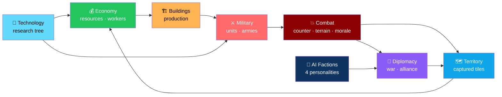
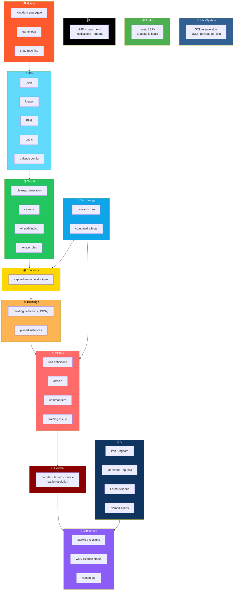

# ⚒️ Empire Forge

<div align="center">


**A 2D top-down real-time strategy / economy / conquest game.**

*Economy creates power · Power creates opportunity · Strategy determines survival*

[⚠️ Build Status](#-honest-build-status-read-first) • [🚀 Build](#-build) • [🏗️ Architecture](#-planned-architecture) • [🎮 Controls](#-intended-controls-target-design) • [📊 Scope](#-scope-vs-the-original-spec)

</div>

---

## 📖 Overview

**Empire Forge** is a **2D top-down real-time strategy / economy / conquest game** built in:

- **C++20**
- **SFML 3**
- **SQLite**
- **JSON data files**

### Design Goal

> **Economy creates power. Power creates opportunity. Strategy determines survival.**

### The Intended Loop



---

## ⚠️ Honest Build Status (Read First)

> **This repository is a work in progress and has NEVER been compiled.**
>
> The authoring environment had **no network access and no display**. The sandbox was also **reset once mid-build**, so some files were rewritten.

> **Expect compile errors on first build. Report them and they can be fixed.**

### 📋 Status Table

<div align="center">

| Area | Status |
|------|:------:|
| **`CMakeLists.txt`** — fetches SFML 3.0.0, SQLite amalgamation, nlohmann/json | 📝 **Written, unbuilt** |
| **`data/*.json`** — buildings, units, technologies, factions, balance | ✅ **Written, JSON-validated** |
| **`src/Utils`** — types, logger, RNG, paths, balance loader | 📝 **Written, unbuilt** |
| **`tests/`** — combat, pathfinding, save/load, diplomacy, tech tests | 🟡 **3 of the test files present** — harness files and CMake still need to be recreated |
| **`src/World`, `Buildings`, `Military`, `Combat`, `Economy`, `AI`, `Diplomacy`, `Technology`, `SaveSystem`, `Audio`, `UI`, `Game`, `main.cpp`** | ❌ **Not yet restored after the reset** |

</div>

> ⚠️ **This is NOT yet a playable game.**
>
> The sections below describe the **target design** the code is being written to.

---

## 📋 Requirements

| Requirement | Version |
|-------------|---------|
| **C++ compiler** | GCC 11+ · Clang 14+ · MSVC 2022 |
| **CMake** | 3.21+ |
| **Internet on first configure** | Dependencies fetched via `FetchContent` — **or** install SFML 3, SQLite3, and nlohmann/json system-wide |
| **Linux dev packages** | SFML needs X11/OpenGL/audio: `libx11-dev libxrandr-dev libxcursor-dev libxi-dev libudev-dev libgl1-mesa-dev libopenal-dev libflac-dev libvorbis-dev` |

---

## 🚀 Build

```bash
cmake -S . -B build -DCMAKE_BUILD_TYPE=Release
cmake --build build -j

cd build && ./EmpireForge        # run from the build dir so data/ and assets/ resolve
ctest --output-on-failure        # unit tests
```

> ⚠️ **Run from the build directory** — so `data/` and `assets/` resolve.

---

## 🏗️ Planned Architecture



### 📂 Project Layout

```
EmpireForge/
├── src/
│   ├── Utils/        types · logger · RNG · paths · balance config
│   ├── World/        tile map generation · camera · A* pathfinding · terrain rules
│   ├── Economy/      capped resource stockpile
│   ├── Buildings/    building definitions (JSON) + placed instances
│   ├── Military/     unit definitions · armies · commanders · training queue
│   ├── Combat/       counter / terrain / morale-based battle resolution
│   ├── AI/           four faction personalities
│   ├── Diplomacy/    pairwise relations · war/alliance status · reason log
│   ├── Technology/   research tree + combined effects
│   ├── SaveSystem/   SQLite save slots (JSON payload per slot)
│   ├── Audio/        music / SFX with graceful fallback when assets are missing
│   ├── UI/           HUD · main menu · notifications · buttons
│   └── Game/         Kingdom aggregate · game loop · state machine
│
├── data/             all tunable gameplay numbers
│                     buildings · units · tech · factions · balance
│
├── tests/            hand-rolled test harness + CTest
│
└── CMakeLists.txt
```

### 🎭 The Four Faction Personalities

<div align="center">

| Faction | Archetype |
|---------|-----------|
| ⚔️ **Iron Kingdom** | Military strength |
| 💰 **Merchant Republic** | Economic dominance |
| 🌲 **Forest Alliance** | Defensive, terrain-aware |
| 🏕️ **Nomad Tribes** | Mobility, raiding |

</div>

### Design Principles

<div align="center">

| Principle | Implementation |
|-----------|---------------|
| **📦 Data-driven balance** | Costs, production, unit stats, research, faction behaviour, and starting resources all live in `data/*.json` — edit without recompiling |
| **🌍 Terrain matters** | Combat resolution includes counter, terrain, and morale — not just raw numbers |
| **🧠 Four personalities** | Each AI faction plays differently — military, economic, defensive, mobile |
| **🤝 Diplomacy is logged** | Pairwise relations with a **reason log** — every decision is traceable |
| **🧪 Hand-rolled tests** | No test framework dependency — a small harness plus CTest |
| **💾 Save slots in SQLite** | JSON payload per slot — structured, queryable, versionable |
| **🔊 Audio degrades gracefully** | Missing assets don't break the game |
| **🚫 No fake features** | The **Honest Build Status** section is the standard |

</div>

---

## 📊 Data-Driven Balance

**Costs, production, unit stats, research, faction behaviour, and starting resources live in `data/*.json`.**

> 💡 **Edit them without recompiling.**

---

## 🎮 Intended Controls (Target Design)

| Input | Action |
|-------|--------|
| **WASD / arrows / screen edge / middle-or-right drag** | Pan camera |
| **Mouse wheel** | Zoom |
| **Left click** | Select building or army / place pending building |
| **Right click** | Move selected army |
| **Space** | Pause |
| **Esc** | Pause menu |

---

## 📊 Scope vs. the Original Spec

### 🎯 First Milestone — The Spec's MVP

- Map
- Base
- Resources
- Workers
- Buildings
- Population
- Basic army
- Enemy kingdom
- Combat
- Territory capture
- Basic AI
- Save / load
- Menu
- Pause
- Basic UI

### ❌ Not Implemented in Any Form Yet

<div align="center">

| Feature | Status |
|---------|:------:|
| **Siege warfare mechanics** | ❌ |
| **Scouting / fog of war** | ❌ |
| **Quests** | ❌ |
| **Random events** | ❌ |
| **Full diplomacy UI** | ❌ |
| **Victory conditions other than conquest** | ❌ |
| **Tutorial flow** | ❌ |
| **Difficulty selection UI** | ❌ |
| **Settings / credits screens** | ❌ |
| **Real art and audio assets** | ❌ — *placeholder shapes are used; text needs a `.ttf` at `assets/ui/font.ttf`* |

</div>

> ⚠️ **We'd rather list what isn't there than ship a fake feature.**

---

## 🗺️ Roadmap

### 🟡 In Progress — First Task: Compile It

- [ ] **Get it to compile** — the first real milestone
- [ ] Recreate `tests/` harness files and CMake integration
- [ ] Restore `src/World`, `Buildings`, `Military`, `Combat`, `Economy`, `AI`, `Diplomacy`, `Technology`, `SaveSystem`, `Audio`, `UI`, `Game`, `main.cpp` after the sandbox reset

### 🎯 MVP Milestone

- [ ] Tile map generation
- [ ] Base building placement
- [ ] Resource economy with capped stockpiles
- [ ] Workers
- [ ] Population
- [ ] Basic army with unit definitions and training
- [ ] Enemy kingdom
- [ ] Combat resolution — counter, terrain, morale
- [ ] Territory capture
- [ ] Basic AI
- [ ] Save / load via SQLite
- [ ] Main menu and pause
- [ ] Basic HUD

### 🔜 Future Ideas

- [ ] **Siege warfare** — walls, gates, siege engines
- [ ] **Fog of war and scouting**
- [ ] **Quests** — scripted and procedural
- [ ] **Random events**
- [ ] **Full diplomacy UI** — treaties, tribute, espionage
- [ ] **Additional victory conditions** — economic, technological, diplomatic
- [ ] **Tutorial flow**
- [ ] **Difficulty selection**
- [ ] **Settings and credits screens**
- [ ] **Real art and audio** — including a proper `.ttf` font
- [ ] **Hot-seat or online multiplayer**
- [ ] **Mod support** — expose JSON schemas

---

## 🤝 Contributing

Contributions are welcome. Please:

1. Fork the repository
2. **Report compile errors you fix** — the project has never been built
3. **Keep balance numbers in `data/*.json`** — data-driven is the contract
4. **Add tests for any new system** — the hand-rolled harness plus CTest is the suite
5. **Preserve the graceful audio fallback** — missing assets must not break the game
6. **Never claim it compiles** without a build log
7. **Never claim it's playable** without a playtest
8. Submit a Pull Request

### Guidelines

- **Never remove an honest limitation** without actually implementing the feature
- **Never hard-code balance values** that belong in JSON
- **Never break save compatibility** without a migration path
- **Never assume the sandbox reset is fully recovered** — verify what's present
- **Never ship without the first successful compile**

---

## 📜 License

**Add your own.**

---

## 🙏 Acknowledgments

- **SFML** — for a 2D rendering API that stays out of the way
- **SQLite** — for save slots that don't need a server
- **nlohmann/json** — for making C++ JSON pleasant
- **Every RTS that ever made you forget to eat dinner** — this one's for you

---

<div align="center">

### ⚒️ ECONOMY. POWER. STRATEGY.

**Economy creates power. Power creates opportunity. Strategy determines survival.**

**Data-driven balance. Four AI personalities. Terrain-aware combat.**

<br>

> ⚠️ **Never compiled. Never played. Honest about both.**

<br>

⭐ If this project interests you, consider giving it a star.

<br>

[⬆ Back to Top](#️-empire-forge)

</div>
